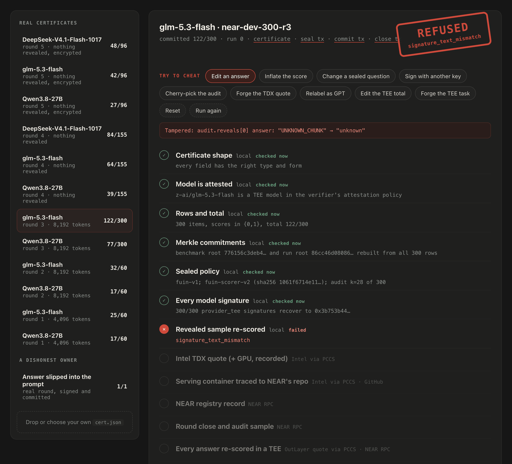
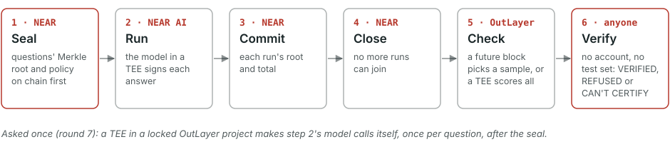

# Fūin

Fūin (封印, pronounced *foo-een*) is Japanese for "seal": the test set is sealed on NEAR before any result is committed.

<picture>
  <source media="(prefers-color-scheme: dark)" srcset="assets/fuin-logo-dark.svg">
  
</picture>

Fūin publishes a private benchmark result that a stranger can check **without an account and without the test set**. Every answer carries a signature from the model's attested TEE key on NEAR AI Cloud, the set and results are committed on NEAR, and every answer is scored inside a TEE on OutLayer. A round can also reveal a sample picked by a future NEAR block, or reveal nothing at all. In round 7 a TEE made every model call itself and recorded one answer per question and counted every retry (round 7 had one), so within that round no owner could quietly re-ask and keep the best answer. Sealing the same questions again as a separate round is still possible: rounds aren't linked.

Built at NEAR HACKATHON (Nov 1–14, 2026), tracks `privacy` and `open`.



*The browser verifier on a real round-3 certificate after "Edit an answer": the checks pass until the revealed sample is re-scored, where the edited answer no longer matches what the model signed.*

## The problem

A benchmark owner has two bad options:

- **Publish the test set.** It leaks into the next model's training data, and the benchmark stops measuring anything.
- **Keep it private.** Then everyone has to take the owner's word for the scores: which model ran, whether answers were edited, and whether the grading was honest.

Fūin is a third option. The owner keeps the questions private. Anyone can check that the published score came from real, unedited answers by a named model running in a TEE, committed before any sample was drawn, and scored correctly against the owner's sealed answer key, over every answer. Whether the questions are any good stays with the owner. Private eval sets are already in use: NEAR's Delta League, for example, ranks fine-tuned models on one ([Illia Polosukhin, Nov 6, 2026](https://x.com/ilblackdragon/status/2118591003368296561)). Fūin certifies models that NEAR AI Cloud serves in an attested TEE, so certifying fine-tuned submissions like those would need them served the same way.

## How it works

<picture>
  <source media="(prefers-color-scheme: dark)" srcset="assets/fuin-flow-dark.svg">
  
</picture>

**seal → run → commit → close → check → verify.**
1. **Seal:** the owner seals a Merkle root over the salted questions, and a policy (request template, settings, scorer, audit size), on the NEAR registry.
2. **Run:** each answer comes from NEAR AI Cloud, signed by the model's TEE key.
3. **Commit:** the owner commits each run's root and total.
4. **Close:** no more runs can join the round.
5. **Check:** a future NEAR block picks a sample to reveal, or a TEE on OutLayer scores every answer.
6. **Verify:** anyone rebuilds everything from the chain and the certificate, and gets one of three outcomes: **VERIFIED**; **REFUSED** with a reason code, when the evidence is wrong; or **CAN'T CERTIFY**, when evidence is missing or unsupported or a service didn't answer. An outage never decides a verdict.

The rounds come in three kinds, each a trade-off:

| | Sampled (`fuin seal`) | TEE-scored (`fuin seal --tee`) | Asked once (`fuin seal --ask`) |
|---|---|---|---|
| Questions revealed | a sample, picked by a future NEAR block | none | none |
| Who calls the model | the owner | the owner | a TEE, once per question, after the seal |
| How scores are checked | anyone re-scores the sample; a TEE re-scores every answer | a TEE re-scores every answer | the TEE scores each answer as it asks |
| Can the owner re-ask a question and keep the best answer? | yes (a printed limit) | yes (a printed limit) | not within a round: the TEE keeps one answer per question and counts any retry. Sealing the same questions as a separate round is still possible; rounds aren't linked |
| Models and token cap | all seven, 8,192 | all seven, 8,192 | fast models only, a smaller cap (DeepSeek-V4.1-Flash at 4,096) |
| Rounds here | 1–3 | 4–6 | 7 |

Every step in detail, with the deployment trace, the answer-key check and end-to-end encryption: [docs/HOW-IT-WORKS.md](https://github.com/fexx301/fuin/blob/main/docs/HOW-IT-WORKS.md).

## Result: which NEAR AI Cloud model answers NEAR developer questions correctly?

Seven rounds of private questions, each answer cited to a line of [near/docs](https://github.com/near/docs) at commit `e2d2ea17`. They produced 20 certificates covering 2,302 answers from seven models. Every model ran with reasoning on and temperature 0. Every committed score was computed over every answer inside a TEE:

| Round | Kind | Questions | Committed score |
|---|---|---|---|
| 7 | asked once, end-to-end encrypted, 4,096 tokens | 37 | DeepSeek-V4.1-Flash **19** |
| 6 | TEE-scored, end-to-end encrypted | 96 | DeepSeek-V4.1-Flash abliterated **40** · DeepSeek-V4.1-Flash **38** · GLM-5.3-flash **33** · Qwen3.6-35B-A3B **22** · Qwen3.8-27B **22** · Qwen3.8-27B abliterated **21** · Qwen3-VL-30B-A3B **11** |
| 5 | TEE-scored, end-to-end encrypted | 96 | DeepSeek-V4.1-Flash **48** · GLM-5.3-flash **42** · Qwen3.8-27B **27** |
| 4 | TEE-scored | 155 | DeepSeek-V4.1-Flash **84** · GLM-5.3-flash **64** · Qwen3.8-27B **39** |
| 3 | sampled, 28 revealed | 300 | GLM-5.3-flash **122** · Qwen3.8-27B **77** |
| 2 | sampled, 23 revealed | 60 | GLM-5.3-flash **32** · Qwen3.8-27B **17** |
| 1 | sampled, 23 revealed, 4,096 tokens | 60 | GLM-5.3-flash **25** · Qwen3.8-27B **17** |

**What the scores show:**
- Rounds 2–6 used 8,192 tokens.
- DeepSeek-V4.1-Flash, in its base or abliterated version, leads rounds 4–6.
- GLM-5.3-flash beats Qwen3.8-27B in all six rounds they share.
- The rounds use different questions, so compare models within a round, not across rounds.

**Answer keys:** in rounds 4–7, which reveal nothing, a TEE checked each answer key against the near/docs line it cites. 374 of 384 appear there, and 10 are flagged as unchecked.

**More detail:**
- [docs/RESULTS.md](https://github.com/fexx301/fuin/blob/main/docs/RESULTS.md): the full table (served builds, revealed breakdowns, cut-offs), what each round disclosed, and how disclosure shrinks as suites grow.
- `evidence/*/README.md`: the transactions for every round.

## For judges

**Quick check (about 2 minutes once dependencies are installed; the first `uv sync` can take 10 minutes on a slow connection; needs [uv](https://docs.astral.sh/uv/) and network, no account or API key):**

```sh
git clone https://github.com/fexx301/fuin && cd fuin
uv sync                                    # first run downloads the dependencies
env -u NEARAI_API_KEY uv run fuin verify examples/cert-near-dev-96-r6-deepseek-v4.1-flash-1017.json   # about 1 minute: VERIFIED, every check printed
uv run pytest -q                           # 5 seconds, offline: every test passes
uv run python scripts/check_fixtures.py examples/tampered/manifest.json   # optional, about 4 minutes: 39 ok lines
```

CAN'T CERTIFY with `evidence_unavailable` means a public service (NEAR's RPC, Intel or NVIDIA) didn't answer, not that the certificate is wrong: run the same command again.

**Full review (optional):**
- Run `scripts/review.sh` in the background. It takes about 30 minutes (allow 45).
- It waits on Intel, NVIDIA, NEAR, OutLayer, GitHub and Docker Hub, and retries when a public service rate-limits it.
- It exits 0 with `ALL CHECKS PASSED`.
- `AGENTS.md` lists the exit codes, what not to run and where the evidence lives.

Every claim maps to a command:

| Claim | Check | Expected |
|---|---|---|
| A stranger can verify a result without an account or the test set | `env -u NEARAI_API_KEY uv run fuin verify examples/cert-near-dev-60-r1-qwen3.8-27b.json` | `VERIFIED`, 10 `[pass]` lines, exit 0 |
| Each answer is signed by the model's TEE-attested key | same output, `signatures` and `attestation` lines | `60/60 provider_tee …`; `quote UpToDate, NRAS True` |
| The served container and weights are traced to NEAR's public deployment repo | same output, `deployment trace` line | `… nearai/cvm-compose-files: model-sg-qwen38-27b-fp8-tp1-coloc …` |
| The set and results were committed on NEAR, with the seal before the commit and the commit before the close | same output, `registry` line | `seal … < commit … < close …` |
| The owner can't choose which items a committed round reveals | same output, `audit sample` line; fixture `changed-audit` | `first final block ≥ close+2`; `REFUSED audit_sample_mismatch` |
| Tampering is refused with a specific reason | `uv run python scripts/check_fixtures.py examples/tampered/manifest.json` | 39 `ok` lines, exit 0 |
| Round 3's totals were re-scored over every answer inside a TEE, not only the sample | `env -u NEARAI_API_KEY uv run fuin verify examples/cert-near-dev-300-r3-glm-5.3-flash.json` | `[pass] tee score: all 300 items rebuilt and re-scored inside an OutLayer TDX enclave … total 122/300 and both roots match` |
| A round can reveal nothing and still be checked, with no answer predating its seal | `env -u NEARAI_API_KEY uv run fuin verify examples/cert-near-dev-155-r4-deepseek-v4.1-flash-1017.json` | `VERIFIED`; `[pass] reveals: none: a TEE-scored round reveals nothing …`; `[pass] tee score: all 155 items rebuilt and re-scored …: total 84/155 …`; fixtures `zero-reveal-unscored`, `zero-reveal-scorer-swapped` |
| A zero-reveal round's answer keys appear in the docs line they cite (a string match, not a check that the key is the right answer) | `env -u NEARAI_API_KEY uv run fuin verify examples/cert-near-dev-96-r6-glm-5.3-flash.json` | `[pass] answer keys: 92/96 answer keys appear in their cited line of near/docs at e2d2ea17, checked inside an OutLayer TDX enclave …; 4 flagged, not checked …: items 14, 35, 46, 94`; fixtures `ground-other-round`, `ground-hidden-flag`, `ground-fork-commit`, `ground-unpinned-build` |
| Each question was asked by a TEE, not by the owner; one answer was kept and every retry counted (no quiet re-asking within the round) | `env -u NEARAI_API_KEY uv run fuin verify examples/cert-near-dev-37-r7-deepseek-v4.1-flash-1017.json` | `VERIFIED`; `[pass] asked once: all 37 answers asked once inside an OutLayer TDX enclave by asker dbbb286b744c… in ask.fuin.testnet/asker … 1 retried ask … every request rebuilt with the seal block's hash … equals the signed one, so every ask came after the seal … ask.fuin.testnet/asker was locked at the seal …`; fixtures `asked-unscored`, `asked-unchecked`, `asked-other-project`, `asked-total-edited`, `asked-check-edited`, `asked-hidden-retry` |
| Questions and answers can stay end-to-end encrypted, so NEAR's gateway never sees them | `env -u NEARAI_API_KEY uv run fuin verify examples/cert-near-dev-96-r5-glm-5.3-flash.json` | `VERIFIED`; the policy line ends `fuin-request-v3 (end-to-end encrypted)`, and the limits print the end-to-end-encryption line; probe: `evidence/2026-11-05-e2ee-probe/` |
| The TEE scorer that ran is this repository's code | `tee/build-docker.sh` (any host with Docker; about 1.5 minutes once the image is pulled) | prints `b301d22b…`, the current pin in `policy/tee-v2.json` (scorer v9: scores as v7, grounds answer keys, runs the asked-check); `ask/build-docker.sh aaa2083` prints `dbbb286b…`, the asker locked in `ask.fuin.testnet/asker`. The earlier accepted builds rebuild the same way from their recorded commits: v8 `bb0d9a5d…` (round 7's grounding, `39a2da3`), v7 `acd9286f…` (groundings of rounds 4–6, `58523c7`), v2 `dabae968…` (rounds 1–4, `6381ee9`), v3 `2614ddaa…` (round 5, `907aec0`), v4 `cd36c486…` (the v4 rehearsal, `54a5b6e`), v5 `86db8213…` (`170c488`), v6 `67c2292e…` (round 6, `6b0705c`) |
| The registry's code can't be replaced (its seal and commit values are also checked against the owner's signed transactions) | `curl -s https://archival-rpc.testnet.fastnear.com -H 'Content-Type: application/json' -d '{"jsonrpc":"2.0","id":1,"method":"query","params":{"request_type":"view_access_key_list","finality":"final","account_id":"registry.fuin.testnet"}}'` | `"keys":[]` |

## Try it (no account, no API key, no test set)

You need uv and network access to these services:
- Intel PCS;
- NVIDIA NRAS;
- an archival NEAR testnet RPC (FastNEAR's by default; set `FUIN_TESTNET_RPC` to pin another);
- the NEAR AI model catalog;
- raw.githubusercontent.com;
- Docker Hub.

One verification takes about a minute.

1. **Verify a real certificate:** `env -u NEARAI_API_KEY uv run fuin verify examples/cert-near-dev-60-r1-qwen3.8-27b.json`.
   - You see `VERIFIED` with ten passing checks: rows, commitments, policy, signatures, reveals, attestation, deployment trace, registry, audit sample and TEE score.
   - It also prints the scope line, the warnings and the limits that apply.
   - The other 19 certificates in `examples/` verify the same way.
2. **Watch tampering get refused:** `uv run python scripts/check_fixtures.py examples/tampered/manifest.json` prints 39 `ok` lines.
   - Each fixture is a real certificate with one change.
   - 29 are REFUSED, 9 are CAN'T CERTIFY, and 1 tricky but valid one must stay VERIFIED.
   - Each fixture and its expected verdict: [docs/REFUSALS.md](https://github.com/fexx301/fuin/blob/main/docs/REFUSALS.md).
3. **Read an audit:** `uv run fuin show examples/cert-near-dev-60-r2-glm-5.3-flash.json --audit` prints each of the 23 revealed questions with its expected answer, docs source, what the model said and its score.
4. **Run the tests:**
   - `uv run pytest`: the offline tests, about 5 seconds.
   - `cd contract && cargo test`: 15 tests.
   - `cd tee && cargo test`: the TEE scorer against Python on 3,600 generated cases, plus signed synthetic rounds.
5. **Try it in a browser:** open [fexx301.github.io/fuin](https://fexx301.github.io/fuin/), or `site/index.html` from the clone. The page verifies certificates in the browser and lets you tamper with one live. It runs every local check, the live NEAR and OutLayer checks, the Intel TDX quote and the deployment trace. NVIDIA's GPU verdict can't run in a browser, so a published certificate shows `fuin verify`'s recorded result for it, matched to its exact bytes, and an uploaded one gets PARTLY CHECKED.

## NEAR tools used

- **NEAR AI Cloud:**
  - TEE-hosted open models through the gateway (`/v1/chat/completions` with `x-no-aliasing`);
  - end-to-end encryption to the model's attested key (`X-Signing-Algo: ecdsa`, `X-Client-Pub-Key`, `X-Model-Pub-Key`);
  - `provider_tee` response signatures (`/v1/signature`);
  - model attestation reports (Intel TDX quote, NVIDIA GPU evidence, event log, compose-manager attestation);
  - the public model catalog (`verifiable`, `attestationSupported`).
- **NEAR testnet contract** [`registry.fuin.testnet`](https://testnet.nearblocks.io/address/registry.fuin.testnet) (Rust, near-sdk 5.30, built with cargo-near):
  - methods: `seal`, `commit_run`, `close_round`, `get_benchmark`, `get_run`;
  - records can't be overwritten, runs are numbered per model, and callers pay for their own storage;
  - **the account has no access keys**, so its code (hash `HvqaWNNceCX7AMtsanPobAt5mkAE2MsZdP2BURA2cgef`) can't be replaced. The verifier checks this.
- **OutLayer** (FastNEAR's verifiable off-chain compute on NEAR):
  - `request_execution` on `outlayer.testnet` runs the TEE scorer in an Intel TDX enclave;
  - an encryption key bound to the scorer's sha256 seals its private key;
  - worker measurements are approved on `worker.outlayer.testnet`;
  - the asker runs as a locked OutLayer project (`ask.fuin.testnet/asker` in round 7, `ask2.fuin.testnet/asker` for new rounds), with sealed project storage and the owner's key stored as an OutLayer secret.
- **FastFS** serves the TEE scorer binary from a NEAR testnet transaction.
- **NEAR block hashes** serve as the audit seed and the seal-bound request nonce; reads go over JSON-RPC at `final` finality.
- **near-cli-rs** signs the owner's transactions; keys stay in the OS keychain.

## Use it

```sh
pip install fuin            # or: uv tool install fuin
fuin verify cert.json       # VERIFIED, REFUSED or CAN'T CERTIFY, with every check printed
```

- **In CI:** a GitHub Action (`uses: fexx301/fuin@v1`) fails the step unless every certificate is VERIFIED.
- **Your own private round:** `fuin evaluate` runs a whole round in one resumable command (or step by step: `fuin check`, `seal`, `run`, `commit`, `close`, `reveal`, `tee-score`, `ask`), `fuin report` turns the certificates into a page to share, and `--max-spend` caps what the model calls can cost: see [docs/USE.md](https://github.com/fexx301/fuin/blob/main/docs/USE.md).
- **A second person trying it:** [PILOT.md](https://github.com/fexx301/fuin/blob/main/PILOT.md) is a step-by-step kit. A fellow builder ran it unmodified on Windows 11 under WSL2. A second outside user ran it on Ubuntu on Nov 11 with one `fuin evaluate` command and no help: 48 questions, two certificates that verify. His questions were written by a model from public pages and no third party verified them, as his own notes say: [evidence/2026-11-11-agriculture-pilot](https://github.com/fexx301/fuin/blob/main/evidence/2026-11-11-agriculture-pilot/README.md).

## Next

Not built. Each waits for a reason:

- **A pilot on a real workload:** another team's own private questions, written from their work and verified by a separate person, published as a case study. The Nov 11 outside run used model-written questions and had no outside verifier, so this is still to do.
- **Structured-output scoring:** JSON fields, required values and numeric tolerances scored inside the TEE. It needs a new scorer in Python, Rust and the browser and a new certificate version, so it waits for a pilot that needs it.
- **Pre-registered campaigns:** an owner declares the models and attempts before running, so a verifier can see whether the published results account for all of them. The registry contract is locked, so this needs a new registry. It could not expose rehearsals made outside the campaign or under another account.

## Limits

Every VERIFIED prints the limits that apply to its certificate. In short:

- Scores are checked on the revealed sample, and on every answer through the TEE score. The TEE score trusts Intel TDX, OutLayer's worker approvals and its key service.
- In a round that reveals nothing, only the owner can see the questions. Answer keys are checked only against the docs line they cite, which doesn't prove a key is the right answer.
- In rounds 1–6 an owner could re-ask a sealed question and commit the best signed answer, and no certificate could show it. In round 7 a TEE asked each question itself and kept one answer; a retry (one in round 7) is counted, and a single draw per item could differ from the total by at most that count. Round 7's asker could miss one retry if two asks of an item overlapped by milliseconds; a second locked asker, used by new rounds, counts every attempt ([evidence](https://github.com/fexx301/fuin/blob/main/evidence/2026-11-11-asker-v2/README.md)). This rests on OutLayer's storage not being rolled back, and separate rounds aren't linked: an owner could seal the same questions again and publish the better round.
- Instances of a model can share a signing key, so a signature doesn't identify the serving instance. Accepted configurations are recorded from NEAR's attested reports, not rebuilt from source.
- Verification is account-free but not offline: it needs the public services listed under [Try it](#try-it-no-account-no-api-key-no-test-set).

The full list, word for word as printed: [docs/LIMITS.md](https://github.com/fexx301/fuin/blob/main/docs/LIMITS.md).

## Libraries and AI-written code

- **When it was written:** everything here was written during the event. The repository's first commit is Nov 3, 2026, and it builds on three small research probes from Oct 24. No earlier code is reused, and there are no templates or boilerplate.
- **AI-written code:** one person built Fūin with AI coding agents. Claude Code wrote most of the code and documentation under the author's direction. Codex, DeepSeek and Claude reviewed it blind; their findings and the fixes are in `evidence/`.
- **A fix from a pilot user:** zkasuran reported, and fixed in pull request #2, a fault that left a round's encrypted gist undeleted on an older GitHub CLI. The change in `src/fuin/tee.py` and its tests follow his pull request (commit `24a7dee`).
- **Python:** rfc8785, requests, eth-account, dcap-qvl, pyyaml, cryptography, sigstore.
- **Rust:**
  - contract: near-sdk, built with cargo-near;
  - scorer and asker: outlayer, wasi, wasi-http-client, serde_json, sha2, sha3, hex, base64, bs58, num-bigint, k256, hkdf, aes-gcm, chacha20poly1305, x25519-dalek, getrandom.
- **Browser, vendored in `site/vendor/` (all MIT):** @noble/curves, @noble/hashes, js-yaml, and @phala/dcap-qvl-web (Phala's WebAssembly build of dcap-qvl).

## Repository

| Path | What |
|---|---|
| `src/fuin/` | the `fuin` command: owner workflow and verifier ([map](https://github.com/fexx301/fuin/blob/main/docs/ARCHITECTURE.md)) |
| `contract/` | the registry contract and its tests |
| `tee/` | the TEE scorer (Rust, WASI P2) and its reproducible build `tee/build-docker.sh` |
| `ask/` | the asker, run as a locked OutLayer project (`ask.fuin.testnet/asker` in round 7, `ask2.fuin.testnet/asker` for new rounds); reproducible build `ask/build-docker.sh` |
| `policy/` | what the verifier accepts: attestation policies, the pinned scorer and asker builds (`tee-v2.json`), sigstore's trust root |
| `site/` | the browser verifier and results page (`verify.js` must agree with the Python verifier on every certificate and fixture) |
| `examples/` | the 20 real certificates; `tampered/` fixtures and their manifest |
| `evidence/` | dated command output, transactions and write-ups behind every claim |
| `docs/` | [how it works](https://github.com/fexx301/fuin/blob/main/docs/HOW-IT-WORKS.md), [results](https://github.com/fexx301/fuin/blob/main/docs/RESULTS.md), [refusals](https://github.com/fexx301/fuin/blob/main/docs/REFUSALS.md), [limits](https://github.com/fexx301/fuin/blob/main/docs/LIMITS.md), [use](https://github.com/fexx301/fuin/blob/main/docs/USE.md), [architecture](https://github.com/fexx301/fuin/blob/main/docs/ARCHITECTURE.md), [costs and dependencies](https://github.com/fexx301/fuin/blob/main/docs/COSTS-AND-DEPENDENCIES.md) |

Running and fixing it: [MAINTAINING.md](https://github.com/fexx301/fuin/blob/main/MAINTAINING.md). Changes: [CHANGELOG.md](https://github.com/fexx301/fuin/blob/main/CHANGELOG.md). MIT licence.
